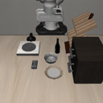
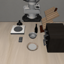

# vla-two-embodiments

A one-week robot-learning study on a fixed budget: free Kaggle T4 GPUs, about 30 GPU-hours, plus a laptop for code only.

1. **Project 1 (main): a mini vision-language-action policy on LIBERO-Goal.** It uses a frozen SmolVLM2-500M backbone and a small action expert trained from scratch. The ablation asks two questions: does language matter, and does flow matching beat L1 regression?
2. **Project 2: DINO-WM on the Wall task.** This is a *reproduction of evaluation and planning with the official checkpoint; training not reproduced.*

Every number below is copied by a script (`scripts/make_readme.py`) from the result files that the Kaggle runs wrote. Every deviation from the papers or the plan is logged in [docs/deviations.md](docs/deviations.md), and every GPU minute is in [docs/gpu_ledger.md](docs/gpu_ledger.md).

## Headline (Project 1)

<!-- BEGIN headline -->
- **Language is what makes the policy work.** With the instruction (A and C pooled): 308/400 = 77.0 % (95 % CI 72.6–80.9). Without it (B, flow matching): 9/200 = 4.5 % (95 % CI 2.4–8.3).
- **Flow matching vs. L1 regression: no resolvable difference.** A (flow): 158/200 = 79.0 % (95 % CI 72.8–84.1); C (L1): 150/200 = 75.0 % (95 % CI 68.6–80.5). Difference +4.0 points; the CIs overlap. With 200 episodes per config, differences of this size cannot be separated from noise.
<!-- END headline -->

## Project 1: what was built

- **Backbone (frozen):** [SmolVLM2-500M-Video-Instruct](https://huggingface.co/HuggingFaceTB/SmolVLM2-500M-Video-Instruct) at a pinned revision. It uses the first 16 of its 32 language-model layers, as `lerobot/smolvla_base` does.
  - Inputs: the main and wrist cameras (64 tokens each) and the instruction.
  - Features are computed once and cached in fp16: 134 prefix tokens per frame, 14.3 GB in total ([results/m2_cache.md](results/m2_cache.md)).
  - Cached features match an online forward pass (min cosine 0.99999 on 10 frames).
- **Action expert (from scratch):** a 6-layer transformer decoder (width 512, 8 heads).
  - It cross-attends to the backbone tokens plus one 8-D robot-state token.
  - It outputs a chunk of 50 × 7-D actions.
- **Heads:**
  - *Flow matching*, as in SmolVLA/π0: linear path, velocity prediction, time drawn from Beta(1.5, 1), 10 Euler steps at inference. A CPU toy test checks it on a 2-D two-cluster distribution ([results/flow_toy.md](results/flow_toy.md)).
  - *L1 regression*: the same expert with a direct output.
- **Training:** the same for all six models.
  - 19,047 steps at batch 64, AdamW with SmolVLA's settings (lr 1e-4, betas 0.9/0.95), 1,000 warm-up steps, then cosine decay to 2.5e-6.
  - fp16 autocast, gradient clipping at 10.
  - About 50 minutes per model on a T4, with two models trained at once, one per GPU.
- **Evaluation:** closed loop in LIBERO-Goal, with the same rules as `lerobot-eval`.
  - All 10 tasks × 10 episodes per model, at most 300 steps per episode.
  - Each predicted 50-step chunk is executed in full, then the model re-plans.
  - Episode *e* always uses start state *e* and seed 1000 + *e*, so every model sees the same 100 episodes.
  - Only the final checkpoint is evaluated; no checkpoint is ever chosen by eval results. Intervals are Wilson 95 % CIs.
- **Ablation:**
  - **A** = language + flow matching.
  - **B** = no language (empty instruction) + flow matching.
  - **C** = language + L1 regression.
  - Each uses seeds 0 and 1.

## Results (Project 1)

Per config (two seeds pooled, 200 episodes each):

<!-- BEGIN per_config -->
| Config | Successes | Rate (%) | Wilson 95 % CI (%) |
|---|---|---|---|
| A: language + flow matching | 158/200 | 79.0 | 72.8–84.1 |
| B: no language + flow matching | 9/200 | 4.5 | 2.4–8.3 |
| C: language + L1 regression | 150/200 | 75.0 | 68.6–80.5 |
<!-- END per_config -->

Per model (100 episodes each):

<!-- BEGIN per_model -->
| Run | Successes | Rate (%) | Wilson 95 % CI (%) |
|---|---|---|---|
| A_s0 | 82/100 | 82.0 | 73.3–88.3 |
| A_s1 | 76/100 | 76.0 | 66.8–83.3 |
| B_s0 | 5/100 | 5.0 | 2.2–11.2 |
| B_s1 | 4/100 | 4.0 | 1.6–9.8 |
| C_s0 | 75/100 | 75.0 | 65.7–82.5 |
| C_s1 | 75/100 | 75.0 | 65.7–82.5 |
<!-- END per_model -->

Per task (successes, seeds pooled):

<!-- BEGIN per_task -->
| Task | A | B | C |
|---|---|---|---|
| 0: open the middle drawer of the cabinet | 14/20 | 0/20 | 14/20 |
| 1: put the bowl on the stove | 17/20 | 3/20 | 18/20 |
| 2: put the wine bottle on top of the cabinet | 15/20 | 3/20 | 18/20 |
| 3: open the top drawer and put the bowl inside | 17/20 | 0/20 | 17/20 |
| 4: put the bowl on top of the cabinet | 19/20 | 3/20 | 15/20 |
| 5: push the plate to the front of the stove | 18/20 | 0/20 | 17/20 |
| 6: put the cream cheese in the bowl | 12/20 | 0/20 | 7/20 |
| 7: turn on the stove | 17/20 | 0/20 | 18/20 |
| 8: put the bowl on the plate | 17/20 | 0/20 | 13/20 |
| 9: put the wine bottle on the rack | 12/20 | 0/20 | 13/20 |
<!-- END per_task -->

Full table: [results/ablation_table.md](results/ablation_table.md). Per-episode results: [results/eval/](results/eval/). Per-run reports with their checks: [results/runs/](results/runs/).

**How to read A vs. C.** A is a few points ahead of C, but the two confidence intervals overlap widely, and the two seeds of A differ by about as much as A and C do. This is a null result at this budget: the experiment cannot tell the two heads apart. It is *not* evidence that they are equal.

## Rollouts

Picked by a fixed rule written down in the plan before the evals: the first success and the first failure of A_s0 in episode order, and B_s0 at the same start state as A_s0's first success.

| A_s0, task 0 ep 0: success | A_s0, task 1 ep 3: failure | B_s0 (no language), task 0 ep 0: failure |
|---|---|---|
|  |  |  |
| "open the middle drawer of the cabinet" | "put the bowl on the stove" | "open the middle drawer of the cabinet" (instruction not given to the model) |

## Project 2: DINO-WM on Wall

**Reproduction of evaluation and planning with the official checkpoint; training not reproduced.**

- Code and checkpoint: the official [DINO-WM](https://github.com/gaoyuezhou/dino_wm) repo (pinned commit) and its released Wall checkpoint (epoch 65).
- Setup: run in the repo's own Python 3.9 / torch 2.3 environment.
- What was compared: MPC-CEM (paper Table 1) and plain CEM (paper Table 8), each on 50 start/goal pairs with seed 99.
- Success rule: the final position is within 4.5 of the goal, computed from simulator states.
- The image decoder is not loaded. It only draws comparison plots and does not fit a 16 GB T4.
- Our own training was dropped: one epoch takes about 2.5 h on a T4, and the official validation loop runs out of memory at batch 128 ([results/p2_r2.md](results/p2_r2.md)).

<!-- BEGIN p2 -->
**MPC-CEM: 46/50 (92%, CI 81.2–96.8) after 4 MPC iterations, stopped by our time limit; the paper reports 0.96; the intervals are consistent.**

| Planner | Successes | Rate (%) | Wilson 95 % CI (%) | Paper | Stopped |
|---|---|---|---|---|---|
| MPC-CEM (plan_wall.yaml) | 46/50 | 92.0 | 81.2–96.8 | 0.96 (Table 1) | after 4 MPC iterations (our 300-min limit; ~75 min per iteration on a T4) |

- Cumulative successes after MPC iterations 1–4: 27, 44, 46, 46 of 50. The paper's 0.96 lies inside our CI.
- The paper does not state its iteration limit (checked in `results/p2_r3.md`), so "after 4 iterations" is our stopping point, not the paper's.
- Plain CEM (paper Table 8: 0.74) has no result. Its run failed at start-up because of our Hydra override (`~planner.max_iter` cannot delete a null key), and a rerun has not been decided.
<!-- END p2 -->

Spec: [docs/p2_spec.md](docs/p2_spec.md).

## Limitations

- **Simulator version:** Kaggle runs MuJoCo 3.8.1, while published LIBERO numbers use MuJoCo 2.3.7. Our success rates are not directly comparable to published ones.
- **Frozen backbone:** `smolvla_libero` fine-tunes the VLM. Ours is frozen with cached features, so there is no image augmentation. The prefix is also causal, with images placed before the instruction, so image features never see the instruction ([docs/deviations.md](docs/deviations.md)).
- **Single embodiment:** only the LIBERO Franka arm. Meta-World was cut this week.
- **Two seeds per config, 100 episodes per model:** a per-config CI is about ±6 points and a per-model CI about ±8–9 points, too wide to resolve A vs. C.
- **Small, budget-limited training:** a small expert, one fixed step count, and only the final checkpoint.
- **Project 2:** our own training was not reproduced, the decoder plots are missing, and 50 start/goal pairs per planner give wide CIs.

## Next steps

1. **Meta-World as a second embodiment.** This gives the repo its name.
2. **LoRA on the backbone.** Feasibility run 2 measured 3.39 GB peak GPU memory and 0.544 s/step at batch 16 on a T4 ([results/feasibility_run2.md](results/feasibility_run2.md)), so it fits the hardware.
3. **World-model action selection.** Sample N action chunks from the flow head and score them with a learned world model, DINO-WM-style. This links the two projects.

## Reproduce

All heavy work runs on Kaggle through `notebooks/runner.ipynb`. The runner clones this repo at a commit, installs pinned packages, runs one script and prints a summary. `scripts/kaggle_run.py` pushes and reads these runs with the Kaggle CLI.

| Step | Command (on Kaggle) |
|---|---|
| Feature cache | `python -m scripts.build_cache` |
| Checks before training | `python -m scripts.m34_checks`, `python -m scripts.flow_toy` (CPU) |
| Train + evaluate two models at once | `python -m scripts.run_pair configs/runs/A_s1.yaml configs/runs/B_s0.yaml` |
| Extra episodes for an existing checkpoint | `python -m scripts.eval_topup` |
| Project 2 planning | `python -m scripts.p2_run r3` |

These two run on the laptop:
- `python -m scripts.make_results_table` builds the results table.
- `python -m scripts.make_readme` fills this README's generated blocks.

Configs: [configs/base.yaml](configs/base.yaml) plus one file per run in [configs/runs/](configs/runs/). Plan: [docs/IMPLEMENTATION_PLAN.md](docs/IMPLEMENTATION_PLAN.md). Data report: [docs/data_report.md](docs/data_report.md).
