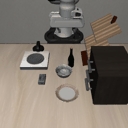
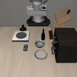
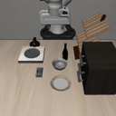
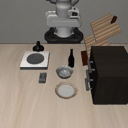

# Video gallery: demo, not part of reported results

**Demo, not part of reported results.** These episodes are not in `results/eval/`, the ablation table or the README numbers. Generated by `python -m scripts.video_gallery` from the saved final checkpoints.

- Start state 10 of every task (seed eval_seed + 10); the evaluation used start states 0-9, so these are new episodes.
- A_s0 (language + flow matching) on all 10 tasks; B_s0 (no language) on tasks 0-2 at the same start state. One episode each: a single episode says nothing about a success rate.
- Exit codes: {'A_s0': 0, 'B_s0': 0}

| Task | Instruction | A_s0 | B_s0 |
|---|---|---|---|
| 0 | open the middle drawer of the cabinet | success (176 steps)  | fail (300 steps)  |
| 1 | put the bowl on the stove | success (87 steps)  | fail (300 steps)  |
| 2 | put the wine bottle on top of the cabinet | success (105 steps)  | fail (300 steps)  |
| 3 | open the top drawer and put the bowl inside | success (178 steps)  | – |
| 4 | put the bowl on top of the cabinet | success (88 steps)  | – |
| 5 | push the plate to the front of the stove | fail (300 steps)  | – |
| 6 | put the cream cheese in the bowl | fail (300 steps)  | – |
| 7 | turn on the stove | success (79 steps)  | – |
| 8 | put the bowl on the plate | success (72 steps)  | – |
| 9 | put the wine bottle on the rack | success (140 steps)  | – |

GIFs: 13, largest 1.61 MB (limit 2 MB).
